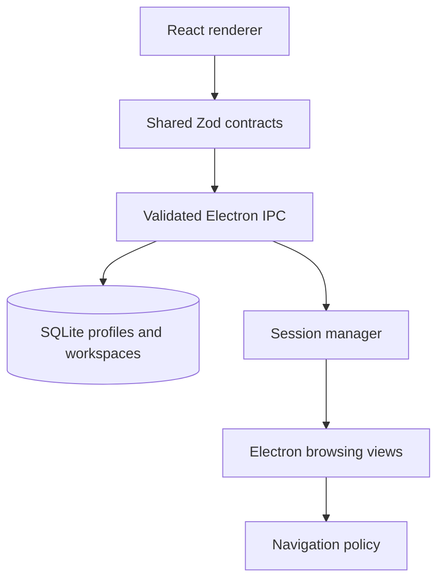

# Persistent Web Workspaces

   [](LICENSE)

A Windows Electron application for organizing browser profiles into persistent workspaces.

Profiles and browsing-session runtime state are deliberately separate: a saved profile is configuration in SQLite; a running Electron view can be starting, visible, hidden, stopped or failed without losing that profile definition.

## Desktop architecture



The monorepo separates [shared contracts](packages/contracts/src/index.ts), the [IPC boundary](apps/desktop/src/main/ipc.ts), [persistence](apps/desktop/src/main/repository.ts) and [session lifecycle](apps/desktop/src/main/session-manager.ts). React does not directly own the database or desktop session operations.

## A profile's input contract

```json
{
  "workspaceId": "00000000-0000-4000-8000-000000000001",
  "name": "Documentation",
  "startUrl": "https://example.com",
  "priority": "normal"
}
```

This synthetic object matches `CreateProfileInputSchema`; it was checked against the existing compiled schema. Session snapshots use `stopped`, `starting`, `online`, `hidden`, `error` and `crashed`. The UUID above is illustrative, not an included workspace.

## Build and open the application

Use **Node.js 24+ and npm 11+** from the repository root:

```console
npm ci --ignore-scripts
npm run typecheck
npm test
npm run build
```

The first Electron launch may require completing the Electron runtime installation when dependency scripts were skipped; review your local installation before `npm run dev` or `npm start`. Build/test success does not replace launching and inspecting an actual desktop window.

The previously recorded clean validation passed type checking, tests and build after restoring the preload source. Account sessions, browsing history and profile databases are private local state and are not distributed with the application source.

**Technology:** TypeScript · Electron · React · Vite · Zod · SQLite · Vitest · npm workspaces

Project-authored source: [MIT](LICENSE). Third-party components retain their own notices and terms.
