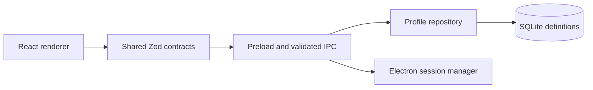

# Persistent Web Workspaces

**Persistent browser profiles and isolated sessions in an Electron desktop workspace.**

   [](LICENSE)

[Overview](#overview) · [Quickstart](#quickstart) · [Example](#example) · [Validation](#validation) · [Documentation](#documentation)

## Overview

A Windows desktop application for organizing browser profiles into workspaces. Profile definitions are persisted in SQLite while Electron manages local browsing sessions. Shared Zod contracts and a validated IPC boundary connect the React renderer to desktop operations.

**Stack:** TypeScript · Electron · React · Vite · Zod · SQLite · Vitest · npm workspaces

## Workspace and session model

| Component | Behavior |
| --- | --- |
| Workspace | Owns named profile definitions and persistent identity. |
| Profile | Stores its workspace, start URL, priority and enabled state. |
| Session | Reports lifecycle, navigation, resource observations and errors. |
| Desktop boundary | URL policy and IPC validation constrain renderer-to-main requests. |

## Processing path



## Quickstart

```console
npm ci --ignore-scripts
npm run build
npm test
npm run typecheck
npm run lint
```

Requires Node.js 24+ and npm 11+. Dependency installation disables lifecycle scripts; Electron binary installation is a separate runtime prerequisite. npm start builds and launches the desktop app only after that prerequisite is satisfied.

## Example

**A profile crosses one shared contract**

Synthetic input matching [CreateProfileInputSchema](packages/contracts/src/index.ts):

```json
{
  "workspaceId": "00000000-0000-4000-8000-000000000001",
  "name": "Documentation",
  "startUrl": "https://example.com",
  "priority": "normal"
}
```

Session snapshots distinguish `stopped`, `starting`, `online`, `hidden`, `error` and `crashed`. Profile persistence and session runtime state have separate responsibilities; this example is not a saved user profile.

## Configuration and storage

Workspace/profile definitions use node:sqlite. Browser storage belongs to the local Electron session and is not distributed as application data. Shared contracts live in their own npm workspace; build them before the desktop package, as the root build script does.

## Repository guide

| Location | Responsibility |
| --- | --- |
| [packages/contracts/src/index.ts](packages/contracts/src/index.ts) | Shared schemas and desktop API |
| [apps/desktop/src/main/ipc.ts](apps/desktop/src/main/ipc.ts) | IPC validation |
| [apps/desktop/src/main/repository.ts](apps/desktop/src/main/repository.ts) | Workspace/profile persistence |
| [apps/desktop/src/main/session-manager.ts](apps/desktop/src/main/session-manager.ts) | Browser-session lifecycle |
| [apps/desktop/src/main/url-policy.ts](apps/desktop/src/main/url-policy.ts) | Navigation policy |

## Validation

Node.js 24.15.0 on Windows: production build, seven unit tests, type checks and lint passed after a fresh dependency install with lifecycle scripts disabled. A packaged Electron application was not launched.

These are the last recorded offline checks (20 October 2026), not a new execution triggered by this documentation revision.

## Scope and operational boundaries

The recorded build, tests, type checks and lint do not certify a packaged Windows executable or every browsing workflow. A packaged Electron application was not launched in the recorded validation. Local sessions may contain authenticated browser data and should remain outside version control.

## Documentation

- [Workspace scripts](package.json)
- [Public renderer/desktop contract](packages/contracts/src/index.ts)

## License and attribution

Project-authored source code is licensed under the [MIT License](LICENSE). Third-party components and datasets retain their respective rights and licenses.
